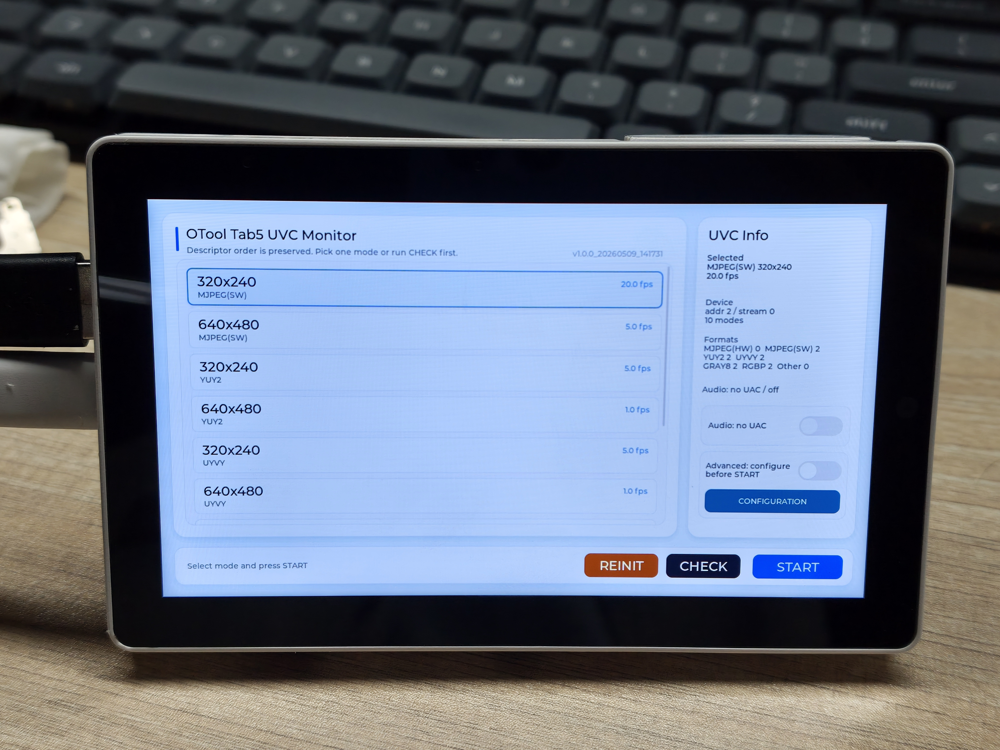
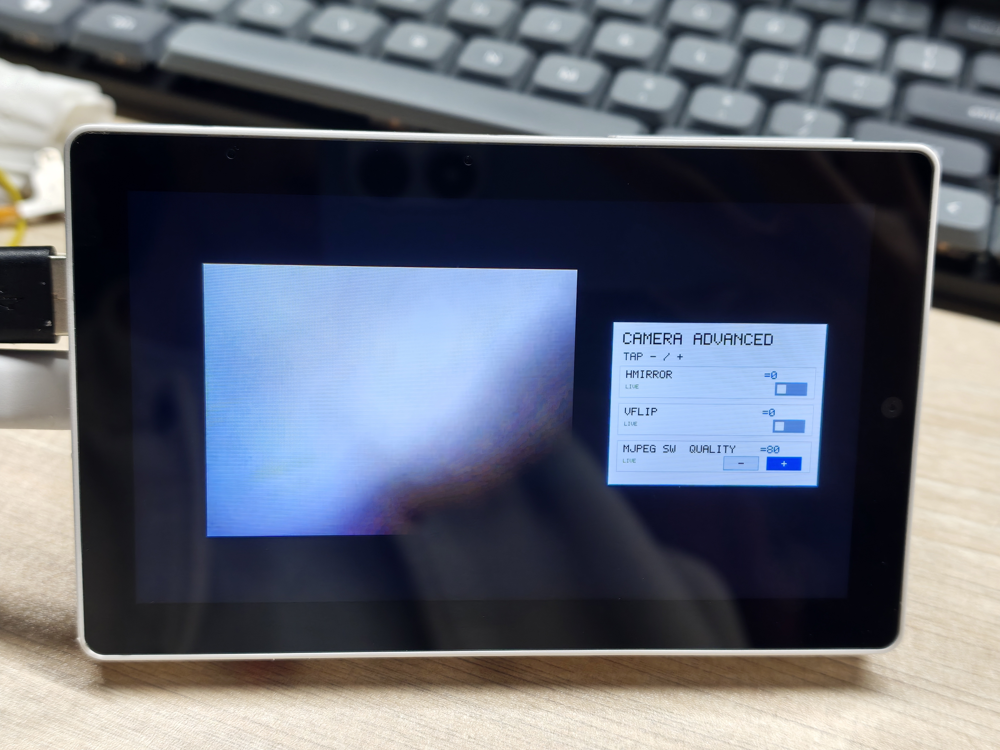

# otool_tab5_uvc_monitor

[](LICENSE)

[简体中文](README.md) | English

A real-time UVC camera display demo for **M5 TAB5 (ESP32-P4)**. The firmware enumerates USB camera modes in an LVGL selection UI, streams the selected format to the built-in DSI panel, optionally enables UAC audio, and can keep a directly rendered advanced camera-control sidebar visible during playback.

| Selection UI | Stream UI With Advanced Controls |
| --- | --- |
|  |  |

The selection screen includes UVC information, Audio, Advanced, `CONFIGURATION`, `REINIT`, `CHECK`, and `START`. The stream screen shows the `CAMERA ADVANCED` sidebar drawn directly on top of the video frame.

---

## Features

- **UVC video streaming**: Enumerates MJPEG(HW), MJPEG(SW), YUY2, UYVY, GRAY8, and RGBP modes from the connected camera.
- **ESP32-P4 hardware acceleration**: Uses the hardware JPEG decoder and PPA scale/rotate path to render a 1280x720 landscape view on the TAB5 display.
- **LVGL 9.x selection UI**: Mode list, UVC summary, build version, Audio switch, Advanced switch, and action buttons.
- **Capability CHECK**: Opens every advertised mode before playback and samples 5 frames from each mode.
- **Advanced camera controls**: Intended only for some of my custom UVC firmware builds, not standard UVC cameras. When compatible firmware advertises and supports matching controls, the UI exposes Contrast, Saturation, HMirror, VFlip, Effect, AE Level, White Balance, and MJPEG quality.
- **USB REINIT**: Cycles USB 5V from the selection screen to recover a stuck camera without rebooting the board.
- **Optional UAC audio**: Detects microphone and speaker interfaces and can draw an audio overlay during streaming.
- **Hot-plug state machine**: Returns to the selection state after camera removal and refreshes automatically after reconnect.
- **Automatic panel detection**: Supports the ST7123, ILI9881C, and ST7121 TAB5 panel variants.
- **FreeRTOS pipeline**: UI, USB Host, video, and audio logic run as cooperating tasks.

---

## Hardware

| Item | Detail |
| --- | --- |
| Board | M5 TAB5 |
| SoC | ESP32-P4, dual-core RISC-V at 400 MHz |
| Display | DSI 720x1280 panel, rendered logically as 1280x720 landscape |
| Camera | USB UVC-compliant camera |
| Audio | USB UAC microphone / speaker device, optional |

---

## Workflow

1. Power on TAB5 and wait for USB camera enumeration.
2. Review detected formats, resolutions, and FPS values in the mode list.
3. Optionally press `CHECK` to open every enumerated mode and confirm that frames arrive.
4. Select a startable mode; optionally enable `Audio` and preconfigure advanced camera controls through `CONFIGURATION`.
5. Press `START` to stop the selection UI and enter the video streaming pipeline.
6. If `Advanced` is enabled and the camera exposes compatible controls, the right-side advanced control panel stays visible during playback.
7. If the camera is stuck before playback starts, press `REINIT` to cycle USB power and enumerate the device again.

---

## Controls

| UI Element | Behavior |
| --- | --- |
| `START` | Starts the selected mode and enters streaming |
| `CHECK` | Opens a check modal and samples 5 frames from every advertised mode |
| `REINIT` | Cycles USB 5V while not streaming, useful for recovering an unresponsive camera |
| `Audio` | Enables UAC microphone / speaker features when compatible interfaces are detected |
| `Advanced` | Only for some of my custom UVC firmware builds; standard UVC cameras are not supported. Keeps the advanced control sidebar visible during playback when compatible firmware supports it |
| `CONFIGURATION` | Opens the advanced control panel; live-safe settings are applied immediately, while others are queued for the next `START` |

---

## Build (ESP-IDF 6.1)

The `esp32p4` target has been build-tested with ESP-IDF `v6.1` and GCC `15.2.0`. Initialize the pinned submodules, then run in an ESP-IDF 6.1 terminal:

```powershell
git submodule update --init --recursive
idf.py build
```

On Windows, a PowerShell with the installed Python environment can first run `. C:\Espressif\frameworks\esp-idf-v6.1\export.ps1`. Defaults are in `sdkconfig.defaults`; `sdkconfig` is generated during the build. The ESP32-P4 port supports PPA rotation automatically, enabled through the display initialization configuration.

`dependencies.lock` pins the managed components used for this build: LVGL `9.6.0~1`, USB Host `1.6.0`, i2c_bus `1.5.2`, esp_codec_dev `1.5.11`, esp_lcd_touch `1.2.1`, and cmake_utilities `0.5.3`. Run `idf.py update-dependencies` to resolve the latest versions allowed by the component manifests again.

The firmware output is `build/c145_tab5_as_camera_display_demo_idf600.bin`. LVGL flag calls, touch reads, and the LCD frame completion callback use the current APIs. A complete ESP-IDF 6.1 rebuild with `idf.py clean build` passed with 0 warnings and 0 errors.

Run `python tools/test_mode_listing_policy.py` to check mode listing and confirmation messages; all 9 checks pass. Native display cropping, scaling, and generated-message checks also passed with ASan/UBSan. This verification does not include flashing or camera/audio hardware tests.

---

## Local USB Components

This project keeps `components/usb_host_uac` and `components/usb_host_uvc` as local components instead of depending directly on the official UAC/UVC packages from IDF Component Manager. The two components are not equally forked: UVC contains project-required local extensions, while UAC is kept local so the USB audio/video components can be pinned and built with one stable layout.

`components/usb_host_uac` is synced to official release `1.5.0` (Espressif `esp-usb` commit `6d24137e14a4f6c8138662a7a074be16a899c2c6`). It includes fractional TX packet sizing for non-integer sample rates and USB packet sizing based on `bSubframeSize`. The local component layout and manifest adaptation avoid the monorepo's `override_path`. The new `subframe_size` member of `uac_host_dev_alt_param_t` should be accessed by name.

`components/usb_host_uvc` includes official release `2.6.0` (commit `516d55da0b051843f50eb36cbc7b9c9dda453a53`), including generic unit/terminal controls, EP0 recovery retries and STALL reporting, descriptor-length checks, and FID-only frame boundaries for cameras without EOF. These project extensions are retained:

- **Additional format enums**: The official UVC component exposes formats such as `MJPEG`, `YUY2`, `H264`, and `H265`; the local component adds `MJPEG_SW`, `UYVY`, `GRAY8`, and `RGBP`, and parses `UYVY`, `Y800/GREY`, `RGBP`, and software-encoded MJPEG descriptors.
- **MJPEG HW/SW split**: The local parser distinguishes `MJPEG(HW)` from `MJPEG(SW)` by reading the MJPEG format descriptor `bmFlags`. This affects the mode list, quality controls, and diagnostics. The official component treats both as plain `MJPEG`.
- **VideoControl control-list API**: The local component adds `uvc_host_ctrl_info_t` and `uvc_host_get_ctrl_list()`, parsing PU/XU `bmControls` from VC descriptors. This lets the selection UI expose Advanced controls before a stream is opened; the official component has no matching public API.
- **BULK URB sizing behavior**: Some cameras report `dwMaxPayloadTransferSize` close to a full frame size. The local BULK path prioritizes the caller-provided `urb_size` so it does not allocate unnecessarily large URBs.
- **ISOC MJPEG complete-frame filtering**: The local `uvc_isoc.c` checks and trims MJPEG frames to EOI before callback, drops frames missing SOI/EOI, and rate-limits related logs so the upper JPEG decoder sees fewer corrupted frames.
- **Timeout and frame-boundary protection**: In-flight EP0 transfers remain protected after a timeout so they cannot be reused or freed prematurely. FID-only boundaries use the same MJPEG validation as EOF, including rejection of frames without EOI.

---

## Notes And Limits

- Modes above **1280x720** are still listed for inspection, but are marked **not recommended** and cannot be started directly; modes above the **1920x1080** hardware processing limit are also listed and marked **hardware unsupported**.
- Advanced controls are intended only for some of my custom UVC firmware builds, not standard UVC cameras; compatible firmware must also advertise the descriptor and respond correctly to UVC `GET_*` / `SET_CUR` transactions.
- `MJPEG(HW) Quality` is not live-safe and is applied on the next stream start.
- `REINIT` is ignored while streaming is already active.
- The committed `sdkconfig.defaults` is tuned for this TAB5 / ESP32-P4 demo. The generated firmware name still follows the CMake project name: `c145_tab5_as_camera_display_demo_idf600`.

---

## Project Structure

```text
main/
  main.cpp              # app_main and the factory-mode preprocessor switch only
  app_runtime.cpp       # board detection, TAB5/LVGL init, and first-screen setup
  app_internal.h        # shared types, constants, and extern declarations
  display_pipeline.cpp  # JPEG decode, PPA scale/rotate, panel flush
  ui/
    ui_selection.cpp      # LVGL selection UI and CHECK / REINIT / CONFIGURATION interactions
    factory_overlay.cpp   # factory waiting screen plus version/FPS overlay during playback
    audio_overlay.cpp     # UAC stream control, waveform/record overlay, touch polling
    advanced_overlay.cpp  # directly rendered CAMERA ADVANCED sidebar during playback
  uvc/
    app_flow.cpp          # USB/UVC/UAC init, REINIT, and hot-plug state machine
    cam_modes.cpp         # mode helpers, selection limits, and factory auto-pick logic
    uvc_callbacks.cpp     # UVC / UAC driver event callbacks
    usb_task.cpp          # USB Host background task plus UVC control probe/apply helpers
    stream_setup.cpp      # stream buffer allocation and release
    video_loop.cpp        # main video-frame consumption and display loop

components/
  otool_dev_autodetect/   # board auto-detection
  otool_tab5_component/   # TAB5 hardware init, panel, touch, and power
  otool_lvgl_idf_port/    # LVGL IDF port for display flush and touch input
  usb_host_uvc/           # USB UVC Host driver with local project extensions
  usb_host_uac/           # USB UAC Host driver merged to upstream 1.5.0
```

---

## Configuration

| Config Group | Purpose |
| --- | --- |
| `CONFIG_UVC_*` | UVC frame buffers, URB size, and related task priorities |
| `CONFIG_UAC_*` | Audio buffer depth, sample-rate behavior, and playback / recording latency |
| `CONFIG_LVGL_*` | LVGL task stack, tick timing, and UI responsiveness |

Selection and overlay limits such as the **1280x720 start cap** and advanced-control defaults are mainly defined in `main/app_internal.h` and `main/uvc/usb_task.cpp`.

---

## License

This project's own code is licensed under the MIT License. See [LICENSE](LICENSE).

Copyright (c) 2026 onexs-xsi

Third-party components and upstream-derived code keep their own license notices in the corresponding directories.
